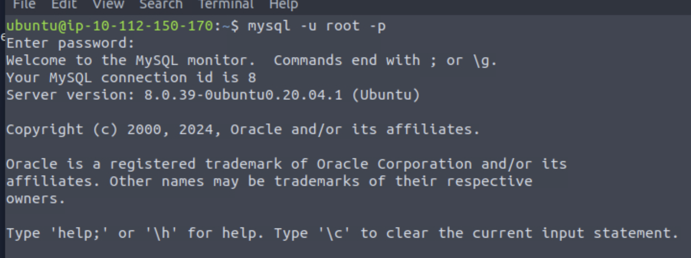
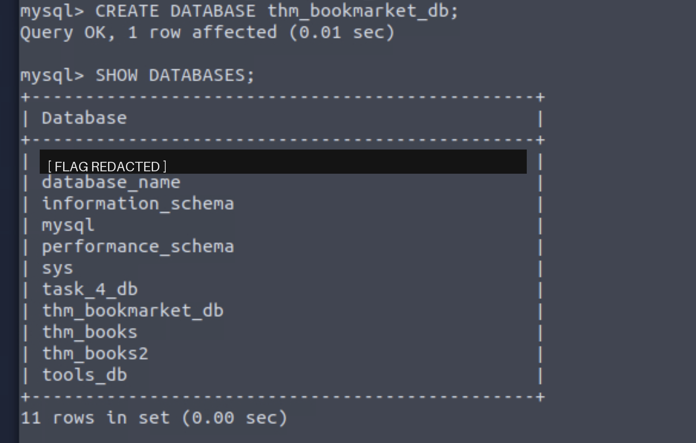
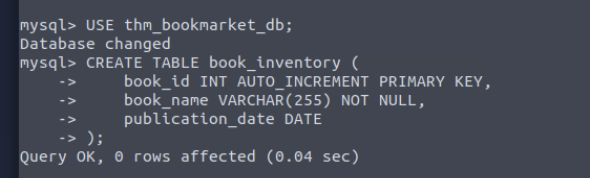
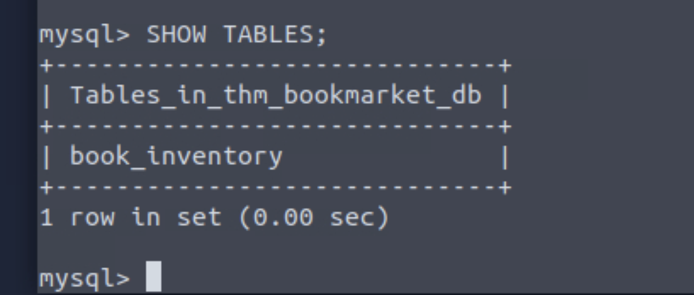
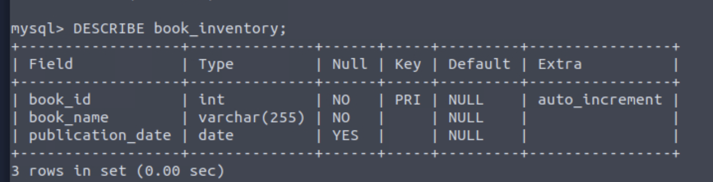
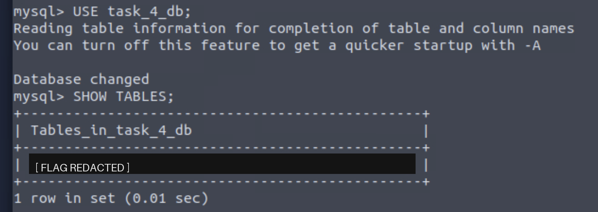
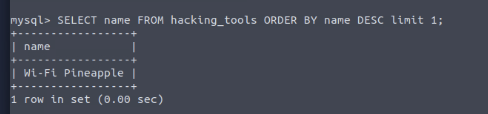
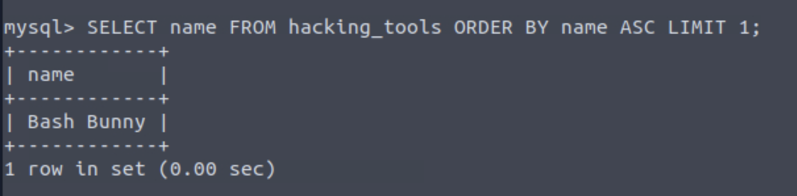
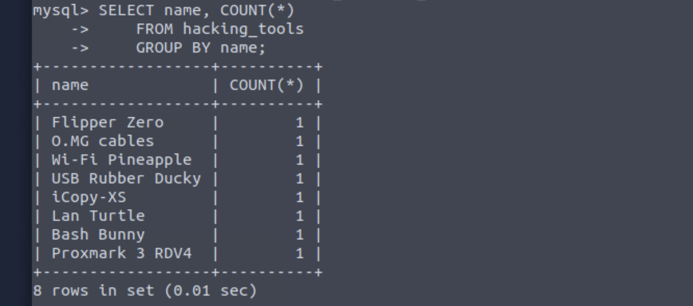

# SQL Fundamentals — TryHackMe

**Room:** [SQL Fundamentals](https://tryhackme.com/room/sqlfundamentals)
**Tools:** MySQL 8.0.39 client on the TryHackMe lab machine (Ubuntu 20.04)
**Completed:** November 3, 2026

---

## Overview

Nearly every web application stores its data in a database, and a lot of attacks (SQL injection especially) only make sense once you know how that data is organised and queried. This room covers the basics of relational databases and SQL in a live MySQL shell.

I worked through it in four steps:

1. **Connect** to the MySQL server
2. **Create** a database and a table, and check the structure
3. **Explore** an existing database to find what's in it
4. **Query** data with `ORDER BY`, `LIMIT` and `GROUP BY`

> Flags are redacted in this write-up and the screenshots, so you'll have to run the queries yourself.

---

## 1. Connecting to MySQL

```bash
mysql -u root -p
```



- `-u root` sets the user, and `-p` makes the client prompt for the password instead of taking it on the command line, where it would end up in shell history.
- The banner shows the server version: **8.0.39-0ubuntu0.20.04.1**. Same idea as a service banner in an Nmap scan: an exact version tells you which known bugs might apply.
- Every statement ends with `;` (or `\g`). Without it, MySQL just waits for more input on a `->` prompt.

---

## 2. Creating a database and a table

### Database

```sql
CREATE DATABASE thm_bookmarket_db;
SHOW DATABASES;
```



`SHOW DATABASES` lists every database the current user can see. A few things I noticed:

- **`information_schema`, `mysql`, `performance_schema` and `sys`** are MySQL's built-in system databases. `information_schema` matters most from a security angle: it describes every database, table and column on the server, so it's the first thing an attacker queries after finding SQL injection.
- The rest (`task_4_db`, `thm_books`, `tools_db`, …) were set up for the room, and one database is named after the flag.
- With root access you see everything. A low-privileged user would only see the databases they've been granted.

### Table

```sql
USE thm_bookmarket_db;

CREATE TABLE book_inventory (
    book_id INT AUTO_INCREMENT PRIMARY KEY,
    book_name VARCHAR(255) NOT NULL,
    publication_date DATE
);
```



`USE` sets the active database, so later statements don't need a `database.table` prefix. In the table definition:

| Column | Definition | Meaning |
|--------|-----------|---------|
| `book_id` | `INT AUTO_INCREMENT PRIMARY KEY` | Whole number, filled in automatically, unique for each row |
| `book_name` | `VARCHAR(255) NOT NULL` | Text up to 255 characters, required |
| `publication_date` | `DATE` | Optional date |

### Checking the result

```sql
SHOW TABLES;
DESCRIBE book_inventory;
```





`DESCRIBE` confirms the schema matches what I wrote:

- `book_id` is the primary key (`PRI`) with `auto_increment`, and `NULL` is `NO`, because a primary key can never be empty.
- `book_name` is `NO` for `NULL` because of the `NOT NULL` constraint.
- `publication_date` allows `NULL` since I didn't add a constraint, so a book can be added without a date.

---

## 3. Exploring an existing database

The next task gave me a database I hadn't built, so I used the same commands to see what was inside:

```sql
USE task_4_db;
SHOW TABLES;
```



The only table was named after the flag. The point is that **`USE` → `SHOW TABLES` → `DESCRIBE`** is how you map out any unfamiliar database, whether you're a developer inheriting a project or a tester who just got a shell.

---

## 4. Querying data

The last tasks used a `hacking_tools` table, which lists hardware hacking gadgets.

### Sorting with `ORDER BY` and `LIMIT`

```sql
SELECT name FROM hacking_tools ORDER BY name DESC LIMIT 1;
SELECT name FROM hacking_tools ORDER BY name ASC LIMIT 1;
```





- `ORDER BY name DESC LIMIT 1` gives the last name alphabetically: **Wi-Fi Pineapple**.
- `ORDER BY name ASC LIMIT 1` gives the first: **Bash Bunny**.

Pairing `ORDER BY` with `LIMIT 1` is a quick way to get the first or last value without scrolling through every row. The sort was also case-insensitive: `iCopy-XS` starts with a lowercase `i` but still sorted among the I's, instead of after every uppercase name. That's because MySQL 8's default collation (`utf8mb4_0900_ai_ci`, where `ci` means case-insensitive) compares letters without regard to case.

### Grouping with `GROUP BY` and `COUNT(*)`

```sql
SELECT name, COUNT(*)
FROM hacking_tools
GROUP BY name;
```



`GROUP BY` collapses rows that share a value, and `COUNT(*)` counts how many rows went into each group:

| Tool | Count |
|------|-------|
| Flipper Zero | 1 |
| O.MG cables | 1 |
| Wi-Fi Pineapple | 1 |
| USB Rubber Ducky | 1 |
| iCopy-XS | 1 |
| Lan Turtle | 1 |
| Bash Bunny | 1 |
| Proxmark 3 RDV4 | 1 |

Every count is 1, so there are **8 distinct tools** and no duplicates. The rows aren't in alphabetical order because I didn't add an `ORDER BY`. Without one, SQL makes no promise about row order.

---

## Key takeaways

- `SHOW DATABASES` → `USE` → `SHOW TABLES` → `DESCRIBE` is the standard way to map out an unknown database.
- `information_schema` describes the whole server's structure, which makes it an attacker's first stop after SQL injection.
- Constraints (`PRIMARY KEY`, `NOT NULL`, `AUTO_INCREMENT`) are enforced by the database itself, and `DESCRIBE` shows them.
- `ORDER BY` + `LIMIT` finds the top or bottom value quickly. Sorting follows the collation, which is case-insensitive by default in MySQL 8.
- `GROUP BY` + `COUNT(*)` summarises data and quickly shows duplicates.
- Row order is never guaranteed without `ORDER BY`.

---
